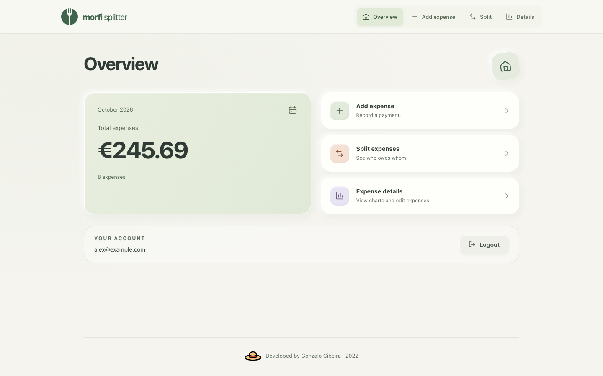
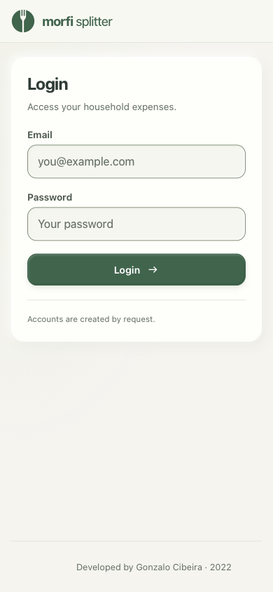
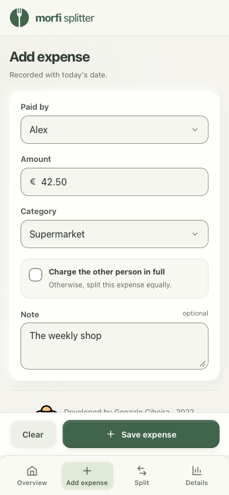
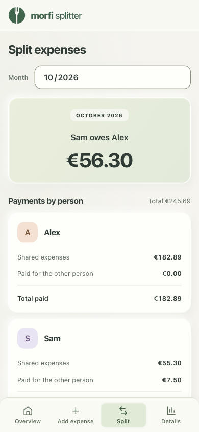
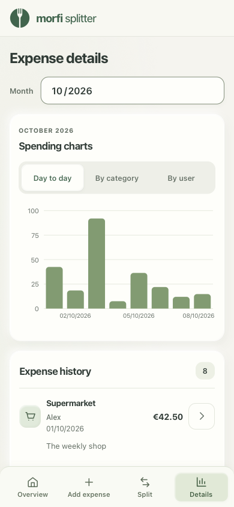
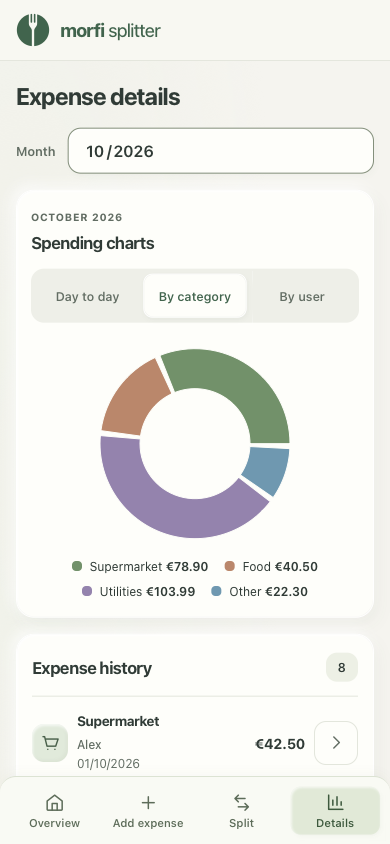
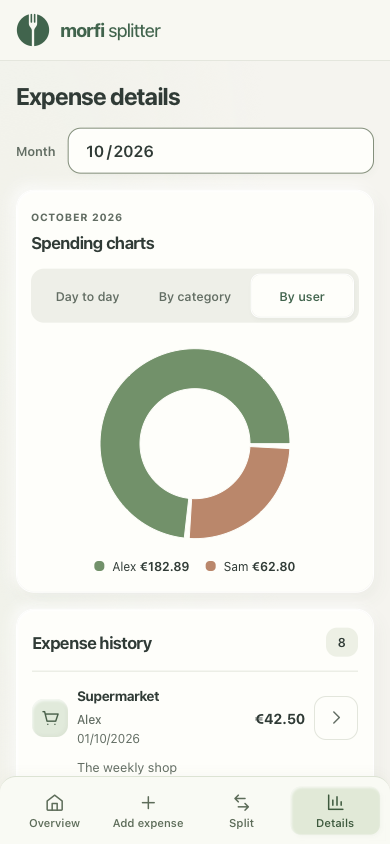
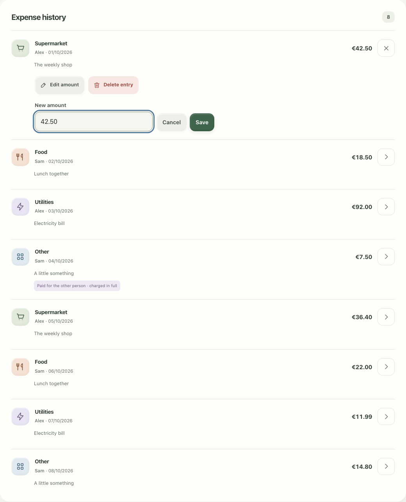

# Morfi Splitter

A React app for splitting monthly household expenses between two people.

Log expenses by participant and category, split shared costs equally, charge purchases made for the other person in full, and review spending by day, category, or participant. Amounts accept decimal commas or dots. Expense history supports amount corrections and confirmed deletion. Accounts are provisioned by request; self-registration is not available.

The interface uses restrained clay styling, clear form labels, and persistent phone navigation. Split and Details share a month selection that starts on the current month and resets when the account changes. Overview always shows the current month.

The logo combines a shared plate and a fork-shaped split. See [the branding notes](docs/branding.md) for the editable vector and icon regeneration command.

## Screenshots

Current UI with example household data.

Monthly overview on desktop:

Login, add an expense, and calculate who owes whom on mobile:

  

Spending by day, category, and participant:

  

Expense history with amount editing and deletion controls:

## Development

Use Node.js 24 (`nvm use`) and install the locked dependencies with `npm ci`.
Set `REACT_APP_FIREBASE_API_KEY` in `.env.local` or the Netlify environment.
The Vite build preserves this existing environment variable name. Missing configuration displays a setup error in the login screen.

- `npm start` starts the local development server.
- `npm run build` creates the production site in `build`.
- `npm run preview` serves the production build locally.
- `npm run test:ci` runs the unit and component tests.
- `npm run test:rules` runs Firestore rules tests; Java 21+ is required on `PATH`.
- `npm audit` checks production and development dependencies.

Netlify builds the `main` branch using Node.js 24 and the settings in `netlify.toml`.
The month selector uses the browser's native month input, with a `YYYY-MM` text fallback in browsers that do not provide a month picker.

## Browser verification and previews

Run `npx playwright install chromium webkit` once, then `npm run test:browser`.
The suite covers desktop Chromium and phone WebKit, including 320, 390, 768, and 1440px layouts, long content, keyboard focus, text zoom, chart switching, edit/delete workflows, and a 1,000-expense fixture. Screenshots and interaction timing samples are saved under `test-results/`.

For a local preview with example data, run `npm run start:test` and open the URL printed by Vite. This uses a separate test configuration that replaces Firebase modules. It does not access real accounts or expenses and is not included in the production build. Available preview scenarios use `?scenario=anonymous`, `empty`, `loading`, `error`, `long`, `large`, `write-error`, or `refresh-error`.

See [the redesign verification report](docs/ui-redesign.md) for changes, bundle measurements, and validation limits.

## Dependency overrides

Security overrides in `package.json` keep Firebase's gRPC transport and CLI dependencies patched until upstream adopts those versions. The CLI uses Chokidar 4 to remove the unpatched `braces` dependency; its Firestore rules watcher accepts a file path. Jest's coverage configuration loader uses JS-YAML 4 to remove the unpatched `sprintf-js` chain. Recheck these overrides when upgrading Firebase tools or Jest.
